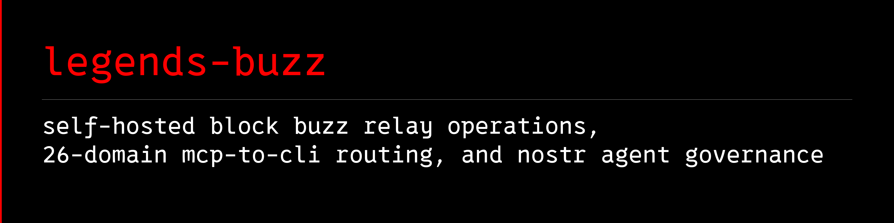
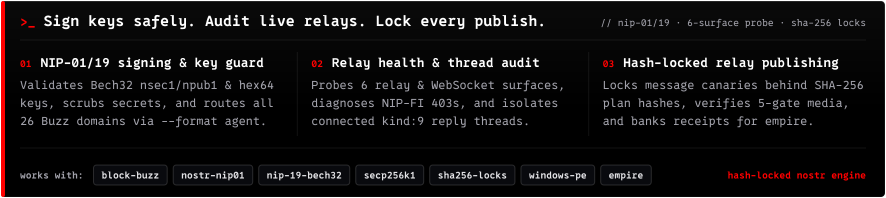
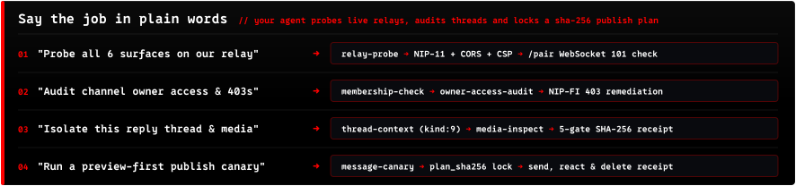
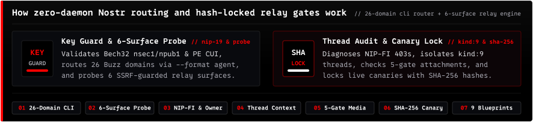
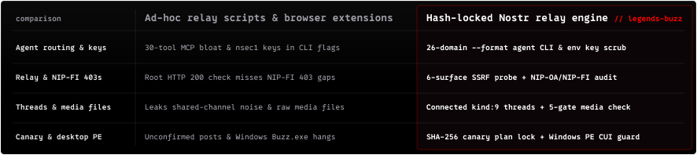

<a name="banner"></a>
<a name="legends-buzz"></a>

# 

[](https://github.com/avalonreset/legends-buzz/releases/latest)
[](https://github.com/avalonreset/legends-buzz/actions/workflows/checks.yml)
[](pyproject.toml)
[](legends_buzz/api.py)
[](legends_buzz/mcp_map.py)
[](LICENSE)

**Zero-dependency Block Buzz Nostr relay messaging, NIP-01/NIP-19 secp256k1 key hygiene, 6-surface relay health audit, and hash-locked publishing CLI (`legends-buzz`) for coding agents: route all 26 Block Buzz domains and 108 subcommands without an ambient MCP daemon, diagnose NIP-OA vs NIP-FI channel membership 403s, reconstruct connected `kind:9` reply threads, inspect untrusted media across five security gates, and attach operational relay runbooks to [`legends-empire`](https://github.com/avalonreset/legends-empire).**


```text
Install or update legends-buzz via cto-legends (https://github.com/avalonreset/cto-legends): run `cto-legends install legends-buzz --apply`, then `cto-legends handoff legends-buzz` and follow the returned JSON recipe to verify `legends-buzz doctor --json`.
```



## Why `legends-buzz` exists

Teams and coding agents deploying or automating self-hosted [Block Buzz](https://github.com/block/buzz) and [Block Buzz App](https://github.com/block/buzz-app) Nostr relays run into four operational traps:

1. **Ambient MCP daemon overhead and secret key sprawl:** Loading a persistent 30-tool chat MCP server per repository burns thousands of startup context tokens, duplicates Nostr private key state across background processes, and breaks when switching relays. Meanwhile, the native `buzz` CLI already exposes all 26 command domains and 108 subcommands with token-compact `--format agent` output.
2. **Residual HTTP `403` on private channels despite valid cryptographic auth:** A valid `BUZZ_PRIVATE_KEY` (`NIP-OA` / `NIP-42`) passes cryptographic verification while `/_readiness` and `/health` return `200 OK`, yet channel reads fail with exit code `3` (`403 relay_membership_required`) when a relay admin's pubkey is missing from the per-channel `NIP-FI` (`kind:39002`) member list or has not redeemed an `/invite/<token>` onboarding link.
3. **Windows NTFS `Buzz.exe` vs `buzz.exe` binary collisions:** When the Tauri GUI desktop app (`Buzz.exe`, `IMAGE_SUBSYSTEM_WINDOWS_GUI`) and the headless Rust CLI (`buzz.exe`, `IMAGE_SUBSYSTEM_WINDOWS_CUI`) share a case-insensitive Windows NTFS directory, installing the desktop client overwrites the CLI binary and causes automated agent calls to pop open a GUI window and hang.
4. **Floating `:latest` container downgrades and untrusted channel attachments:** Pulling floating `ghcr.io/block/buzz:latest` images against a PostgreSQL 17 database with newer SQLx migrations causes `buzz-relay` to crash-loop with `MigrateError::VersionMissing`, while opening raw channel attachments without `imeta` hash binding or XML/ZIP guards exposes agents to spoofed payloads.

`legends-buzz` solves these with a **zero-dependency Python 3.11+ standard-library CLI** that enforces BIP-173 Bech32 `nsec1`/`npub1` and 64-character hex key hygiene, Windows PE subsystem verification, SSRF-hardened 6-surface relay probes, connected `kind:9` reply thread isolation, 5-gate zero-trust attachment inspection, preview-first SHA-256 mutation locks, and an attachable [`legends-empire`](https://github.com/avalonreset/legends-empire) knowledge pack.

## Ask in plain english

Once [`cto-legends`](https://github.com/avalonreset/cto-legends) is installed, you ask your coding agent in plain english. It maps the exact `buzz` CLI route, probes the relay or reconstructs the thread read-only first, and locks any live canary write behind a SHA-256 confirmation hash:



## Architecture: zero-daemon Nostr routing and hash-locked relay gates



### 1. BIP-173 Bech32 key hygiene, Windows PE CUI guard, and 26-domain CLI router

Before invoking a single relay operation, `legends-buzz` enforces strict local credential, binary, and routing boundaries:

- **Full BIP-173 Bech32 and hex64 key validation with automatic output scrubbing:** `classify_key()` and `normalize_pubkey()` validate mixed-case rules, exact 63-character lengths, BIP-173 polymod checksums, and 64-character hex public keys (`nsec1...`, `npub1...`, and `hex64`). Secret keys (`BUZZ_PRIVATE_KEY`, `BUZZ_NSEC`, `BUZZ_PRIVATE_KEY_HEX`) and federated identity tokens (`BUZZ_FEDERATED_IDENTITY_TOKEN`) are passed strictly via child process environment variables (`shell=False`), never via CLI flags, and `scrub_secrets()` redacts them from all stdout, stderr, and error traces.
- **Pre-resolve symlink refusal and Windows PE subsystem verification (`legends_buzz/desktop.py`):** Before executing `buzz.exe` on Windows, `legends-buzz` inspects the Portable Executable Optional Header `Subsystem` field. If a binary reports `IMAGE_SUBSYSTEM_WINDOWS_GUI` (`2`) instead of `IMAGE_SUBSYSTEM_WINDOWS_CUI` (`3`), `legends-buzz` refuses to launch the GUI executable, falls back to `bin\buzz.exe`, and flags `ntfs_buzz_exe_case_collision` in `desktop-audit` and `doctor`.

### 2. The 12-workflow `legends-buzz` CLI surface

Every subcommand in `legends-buzz` emits deterministic JSON (`--json`) or Markdown (`--format markdown`) with canonical channel UUID and 64-character hex event validation to prevent subprocess option injection:

| Surface | `legends-buzz` Subcommands | What It Does |
| :--- | :--- | :--- |
| **Runtime, Grammar & PE Audit** | `doctor`, `resources`, `cli-inventory`, `desktop-audit` | Verifies Python 3.11+ readiness, packaged knowledge-pack hashes, installed `buzz` CLI grammar (`--format agent` and `NIP-FI` support), Windows PE CUI vs GUI headers, and embedded WebView assets. |
| **26-Domain MCP-to-CLI Router** | `mcp-map [--domain <d>] [--intent <q>]` | Maps all 26 Block Buzz command domains and 108 subcommands (`messages`, `channels`, `projects`, `repos`, `mem`, `sidebar`, `huddles`, `moderation`, `workflows`, `notes`) to exact `buzz` CLI calls (`--format agent`) and exit codes (`0..5`). |
| **6-Surface SSRF-Guarded Probe** | `relay-probe --relay <url>` | Pinned-IP HTTPS/WSS probe verifying `/_readiness`, `/health`, NIP-11 relay metadata (`Accept: application/nostr+json`), Tauri WebView CORS (`Origin: tauri://localhost`), `/invite/*` CSP onboarding edge, and `/pair` RFC 6455 WebSocket `101 Switching Protocols` (`buzz-pair-relay`) without following redirects. |
| **Membership & Owner Governance** | `membership-check`, `owner-access-audit` | Distinguishes active `member` access from `residual_403` (`relay_membership_required` needing `/invite/<token>`) and `nip_fi_required`, and audits explicit `owner`/`admin` role coverage across visible channels using Bech32 `npub1...` or 64-character hex pubkeys. |
| **Channel Snapshots & `kind:9` Threads** | `channel-snapshot`, `thread-context` | Captures channel metadata, member rosters, collaborative Markdown canvases, and recent messages, or walks Nostr `kind:9` `["e", "<parent_id>"]` reply tags to isolate the exact connected conversation component without unrelated shared-channel chatter. |
| **5-Gate Zero-Trust Media Inspector** | `media-inspect` | Verifies same-relay HTTPS origin, `/media/<64hex>` path binding, event NIP-92 `imeta` tag binding, SHA-256 digest, and magic bytes before bounded `.docx`/`.xlsx`/`.csv`/`.json`/`.md` extraction with full-buffer Expat XXE and zip-bomb stream ceilings. |
| **Hash-Locked Canary & Blueprints** | `message-canary`, `relay-upgrade-plan`, `blueprint` | Computes a zero-write `plan_sha256` preview before executing `send -> get -> reactions add -> reactions remove -> delete` with guaranteed `finally:` cleanup, generates 8-gate isolated `--internal` Docker Postgres 17 migration plans, and emits 9 server/ACP blueprints. |

### 3. Production relay blueprints and attachable `legends-empire` knowledge pack

- **9 production relay and ACP agent blueprints (`legends-buzz blueprint`):** Emit ready-to-review configurations for `docker-compose-traefik`, `docker-compose-caddy`, `mobile-invite-edge`, `postgres-migration-49-60-preflight`, `stage-upgrade-verify`, `acp-subscription-agent`, `isolated-subscription-acp-launcher`, `durable-bridge-guard`, and `systemd-alert-timer`.
- **Attachable [`legends-empire`](https://github.com/avalonreset/legends-empire) knowledge pack (`knowledge/buzz/pack.json`):** Ships with a `legends.knowledge-pack/v1` operational library and [wiki/index.md](wiki/index.md) covering 26-domain CLI routing, `NIP-OA` vs `NIP-FI` identity troubleshooting, zero-downtime Postgres 17 relay upgrades, and private operation receipt templates ([templates/private-operation-receipt.md](templates/private-operation-receipt.md)).

## Ad-hoc relay scripts vs `legends-buzz`



## Quick start

```sh
# 1. Verify offline readiness, CLI capability inventory, and Windows Desktop PE safety
legends-buzz doctor --json
legends-buzz resources --json
legends-buzz cli-inventory --json
legends-buzz desktop-audit --json

# 2. Query the 26-domain / 108-subcommand MCP-to-CLI router
legends-buzz mcp-map --intent "unread channels and thread replies"
legends-buzz mcp-map --domain projects --format markdown
legends-buzz mcp-map --domain mem --format markdown

# 3. Probe all 6 relay surfaces and check authenticated channel membership
legends-buzz relay-probe --relay https://buzz.example.com --json
legends-buzz membership-check --relay https://buzz.example.com --env-file buzz.env --json

# 4. Audit owner governance, snapshot a channel, isolate a kind:9 thread, and inspect media
legends-buzz owner-access-audit --relay https://buzz.example.com --env-file buzz.env --expected-pubkey <owner-npub-or-hex> --json
legends-buzz channel-snapshot --relay https://buzz.example.com --env-file buzz.env --channel <channel-uuid> --limit 10 --json
legends-buzz thread-context --relay https://buzz.example.com --env-file buzz.env --channel <channel-uuid> --event <64hex-event-id> --limit 20
legends-buzz media-inspect --relay https://buzz.example.com --env-file buzz.env --channel <channel-uuid> --event <64hex-event-id> --url https://buzz.example.com/media/<64hex-sha256>.csv --sha256 <64hex-sha256> --mime text/csv --extract-mode data

# 5. Preview and apply a hash-locked disposable message canary
legends-buzz message-canary --relay https://buzz.example.com --env-file buzz.env --channel <test-channel-uuid>
legends-buzz message-canary --relay https://buzz.example.com --env-file buzz.env --channel <test-channel-uuid> --apply --confirm-plan <plan_sha256>

# 6. Generate an 8-gate relay upgrade plan and inspect production blueprints
legends-buzz relay-upgrade-plan --relay https://buzz.example.com --target-digest ghcr.io/block/buzz@sha256:<digest> --format markdown
legends-buzz blueprint --list
legends-buzz blueprint --name docker-compose-traefik --output docker-compose.yml
```

## Reference

<details>
<summary><strong>Knowledge vault, relay runbooks, and <code>legends-empire</code> integration</strong></summary>

Start at [wiki/index.md](wiki/index.md) or attach the versioned knowledge pack at [knowledge/buzz/pack.json](knowledge/buzz/pack.json) (`legends.knowledge-pack/v1`). Attach into a [`legends-empire`](https://github.com/avalonreset/legends-empire) vault or read it directly as plain Markdown.

- **Operational runbooks:** [Block Buzz Knowledge Vault Index](wiki/index.md), [Knowledge Pack & Empire Attachment Guide](docs/KNOWLEDGE-PACK.md), [Release & Verification Procedure](docs/RELEASE.md), and [Primary Sources & Citations](references/sources.md).
- **Private operating templates:** Use [templates/private-operation-receipt.md](templates/private-operation-receipt.md), [templates/relay-upgrade-receipt.md](templates/relay-upgrade-receipt.md), and [templates/canary-verification-receipt.md](templates/canary-verification-receipt.md) to keep private relay inventories, migration rehearsals, and canary receipts in your own vault outside public repositories.

</details>

<details>
<summary><strong>Agent setup (via <code>cto-legends</code>) and standalone installation</strong></summary>

### Agent setup (via `cto-legends`)

Part of the [cto-legends](https://github.com/avalonreset/cto-legends) ecosystem. `cto-legends` is the only registered skill; this repository vendors a pinned copy at [skills/cto-legends/SKILL.md](skills/cto-legends/SKILL.md).

The product, repository, Python distribution, and catalog ID are `legends-buzz`.

Install with `cto-legends install legends-buzz`, then follow the module recipe the router loads ([docs/AGENT-RECIPE.md](docs/AGENT-RECIPE.md)). Do not register this module as its own standalone skill.

```sh
git clone https://github.com/avalonreset/legends-buzz.git
cd legends-buzz
python -m pip install -e .
legends-buzz doctor --json
legends-buzz resources --json
```

Pass `BUZZ_PRIVATE_KEY` (`nsec1...` or 64-character hex) and `BUZZ_RELAY_URL` via the process environment or `--env-file <path>`. Never pass private keys on command-line flags.

</details>

<details>
<summary><strong>Repository layout, verification, and FAQ</strong></summary>

```text
Operator / Agent
  -> legends-buzz CLI (doctor, resources, mcp-map, cli-inventory, desktop-audit, relay-probe)
  -> Read-only governance & thread isolation (membership-check, owner-access-audit, channel-snapshot, thread-context, media-inspect)
  -> Preview-first canary plan builder (plan_sha256, writes_sent=0) + explicit --apply --confirm-plan
  -> Guaranteed finally: cleanup delete + attachable legends-empire knowledge pack
```

- `legends_buzz/`: Zero-dependency Python 3.11+ CLI (`cli.py`), SSRF-hardened relay probes and 5-gate media inspector (`api.py`), 26-domain MCP-to-CLI reference router (`mcp_map.py`), Windows PE and WebView asset auditor (`desktop.py`), 9 production blueprints (`blueprints.py`), and packaged resource resolver (`resources.py`).
- `wiki/` and `knowledge/buzz/`: Source-cited Block Buzz and Nostr NIP-29/NIP-OA/NIP-FI runbooks and attachable [`legends-empire`](https://github.com/avalonreset/legends-empire) knowledge pack.
- `docs/`: [Agent Operating Recipe](docs/AGENT-RECIPE.md), [Knowledge Pack & Empire Attachment Guide](docs/KNOWLEDGE-PACK.md), and [Release & Verification Procedure](docs/RELEASE.md).

```sh
python -m unittest discover -s tests -v
python scripts/check_release.py
```

- **Do I need an ambient MCP daemon to let AI agents use Block Buzz?** No. The standalone `buzz` CLI natively supports all 26 command domains and 108 subcommands with `--format agent` (stripping 64-byte Schnorr signatures and `NIP-OA` auth boilerplate while folding `NIP-10` thread markers into `reply_to` and `thread_root`). `legends-buzz mcp-map` gives any agent instant lookup of exact CLI syntax and exit code semantics (`0..5`).
- **How does `legends-buzz` prevent the Windows `Buzz.exe` vs `buzz.exe` collision?** Before invoking `buzz.exe` on Windows, `legends-buzz` inspects its Portable Executable Optional Header `Subsystem` field and refuses to execute `IMAGE_SUBSYSTEM_WINDOWS_GUI` (`2`) binaries as a CLI subprocess.

</details>

## Contributing, security, and license

See [CONTRIBUTING.md](CONTRIBUTING.md), [SUPPORT.md](SUPPORT.md), [CODE_OF_CONDUCT.md](CODE_OF_CONDUCT.md), [SECURITY.md](SECURITY.md), and [CHANGELOG.md](CHANGELOG.md).

MIT License. See [LICENSE](LICENSE), [NOTICE.md](NOTICE.md), and [THIRD_PARTY_NOTICES.md](THIRD_PARTY_NOTICES.md).

## Start here

Paste the [agent handoff block](#top) at the top of this page into your coding agent, let it wire the `cto-legends` router skill, and speak your task in plain English.

Running a company and not a terminal? Founders and operators who want this way of working applied directly to their own business stack have one route: message Avalon Reset at [cto-legends.com/dm](https://cto-legends.com/dm) or start with a 48-hour diagnostic at [cto-legends.com/home#home-offer](https://cto-legends.com/home#home-offer). The desk is async, so the conversation starts the moment you write and nobody forces you onto a sales call.

<p align="center"><a href="https://cto-legends.com/dm"></a></p>

<p align="center"><a href="https://github.com/stars/avalonreset/lists/cto-legends"></a></p>

**Specification & benchmarks on cto-legends.com:**
- **Module specification & architecture matrix:** [cto-legends.com/modules/legends-buzz](https://cto-legends.com/modules/legends-buzz)
- **Related engineering dispatches:** [MCP vs CLI: The 46x Token Tax & Prompt-Cache Architecture](https://cto-legends.com/blog?post=mcp-vs-cli) · [AI Agent Governance: PreToolUse Kernel Gates & Context Compaction](https://cto-legends.com/blog?post=ai-agent-governance) · [Hetzner vs DigitalOcean: Sovereign Bare-Metal & Coolify TCO](https://cto-legends.com/blog?post=hetzner-vs-digitalocean)
- **Ecosystem hub:** [cto-legends.com/home](https://cto-legends.com/home)
